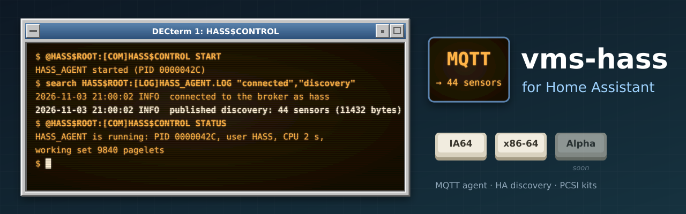

  

# vms-hass

OpenVMS systems in [Home Assistant](https://www.home-assistant.io). A native agent on
each node publishes the system's state over **MQTT**, and Home Assistant's MQTT
discovery turns each node into a **device** with typed sensors: no YAML to write. The
sensors keep history and long-term statistics, go on dashboards, and drive alerts and
automations next to everything else Home Assistant watches.

It is written for OpenVMS from scratch in C99: VSI C on x86-64 and Integrity (IA64),
VSI's OpenSSL 3 kit for TLS. The agent connects out to the broker, so nothing listens
on the VMS system, and it runs as an unprivileged account of its own. It is
**read-only**: Home Assistant cannot act on the node.

Part of the same family as [vmsotel](https://github.com/issinoho/vmsotel),
[the beszel agent](https://github.com/issinoho/vms-beszel), [VTOP](https://github.com/issinoho/vms-vtop)
and the other [ports and tools for OpenVMS](https://openvms.issinoho.com).

**Status: 0.1.0, an early test release.** It runs on both test nodes (x86-64 E9.2-4
and IA64 V8.4-2L3), installed from the kit and publishing to Home Assistant, without a
break since 26 October 2026. Not yet seen: a start at boot through a real reboot, and
TLS against a real broker (tested on Linux only). See [docs/PLAN.md](docs/PLAN.md) and
[docs/PHASE4.md](docs/PHASE4.md).

## What it publishes

| Group | Sensors |
| --- | --- |
| CPU | busy %, each VMS mode (user, supervisor, executive, kernel, interrupt, MP synchronisation, idle), compute queue |
| Memory | used %, free, modified page list, size |
| Paging | page and swap file use % |
| Disks | each mounted disk: used %, free, size, error count, and a **problem** sensor (mount verification, offline, errors rising) |
| Network | each LAN device: receive and transmit rates |
| System | boot time, processes, interactive users, active CPUs; the device shows the VMS version and hardware model |
| Queues | each execution queue on the node and each generic queue: state, pending and executing jobs, and a **problem** sensor (stopped, stalled, paused, unavailable) |
| Shadow sets | each set: state, full members, copy or merge progress, and a **problem** sensor |
| Cluster | members, votes and quorum (cluster members only) |

The problem sensors are ready for Home Assistant alerts and automations. A node that
stops reporting goes `unavailable` within one keepalive period (the MQTT last will),
and the device comes back by itself after a restart of the agent, the broker or Home
Assistant. Disks, LAN devices, queues and shadow sets that come or go are added to or
removed from the device as they do.

## Safety

- **Its own account:** `HASS$CONFIGURE` creates it in a UIC group no other account
  uses, with NETMBX and TMPMBX only and no way to log in. The agent refuses to run as
  SYSTEM or with privileges.
- **The broker password** is in a file readable by the agent's account only; the agent
  refuses one others can read, and never logs it.
- **TLS** to the broker, with its certificate and host name always verified. Without
  TLS, the agent warns at every start that the password and readings cross the network
  unencrypted.
- **It connects out**, so nothing listens on the VMS system, and it is read-only.
- **A stable identity:** the node's ID is made once from the SCS node name and system
  ID and kept, so Home Assistant keeps the device and its history across restarts.

## Installing

The kits need VSI TCP/IP Services, VSI's SSL3 kit, and an MQTT broker that Home
Assistant uses (for example the Mosquitto app and the MQTT integration). A kit
downloaded through a non-VMS system loses its record format. As SYSTEM, restore it and
install:

    $ SET FILE/ATTRIBUTE=(RFM:FIX,LRL:8192,MRS:8192,RAT:NONE) ISSINOHO-*-HASS-V0001-0-1.PCSI
    $ PRODUCT INSTALL HASS /PRODUCER=ISSINOHO /SOURCE=dev:[dir]

Then:

1. In Home Assistant, make an MQTT user for the agent.
2. Create the agent's account and set the protections: `@HASS$ROOT:[COM]HASS$CONFIGURE`.
3. In `HASS$ROOT:[CONF]AGENT.CONF` (made from `AGENT.CONF_TEMPLATE`, which explains
   every setting) set `MQTT_HOST` and `MQTT_USER`; put the password alone in
   `HASS$ROOT:[CONF]MQTT.PWD`; run `HASS$CONFIGURE` again to protect both.
   `AGENT := $HASS$ROOT:[BIN]HASS_AGENT.EXE` then `AGENT --PRINT` shows what it would
   publish, without connecting.
4. `@HASS$ROOT:[COM]HASS$CONTROL START`. Within a minute the node appears in Home
   Assistant under Settings, Devices & services, MQTT. `STOP`, `RESTART` and `STATUS`
   work the same way.
5. At boot and shutdown, add `$ @SYS$STARTUP:HASS$STARTUP.COM` to
   `SYS$MANAGER:SYSTARTUP_VMS.COM` (after TCP/IP) and `$ @SYS$STARTUP:HASS$SHUTDOWN.COM`
   to `SYS$MANAGER:SYSHUTDWN.COM`.

`README.VMS` in the kit has the details; [docs/CONFIG.md](docs/CONFIG.md) lists every
setting and topic. `PRODUCT REMOVE HASS` stops the agent and keeps its configuration,
identity and log.

## Building from source

On OpenVMS, with VSI C and SSL3:

    $ @build_vms TEST               ! the agent, its launcher and the unit tests

From Linux, `tools/kit.sh <node>` builds on a node, runs the tests there and makes the
kit. On Linux itself, `make test` runs the same unit tests against a stub platform, and
`make integration` runs the agent against a local Mosquitto.

## Artwork

`docs/images/banner.svg` and `docs/images/icon.svg` were made for this project in the
style of classic DECwindows and VT terminals, like those of its sibling ports.

## Licence

MIT. See [LICENSE](LICENSE).

OpenVMS is a trademark of VMS Software, Inc. Home Assistant is a project of the Open
Home Foundation. This project is not affiliated with either.
